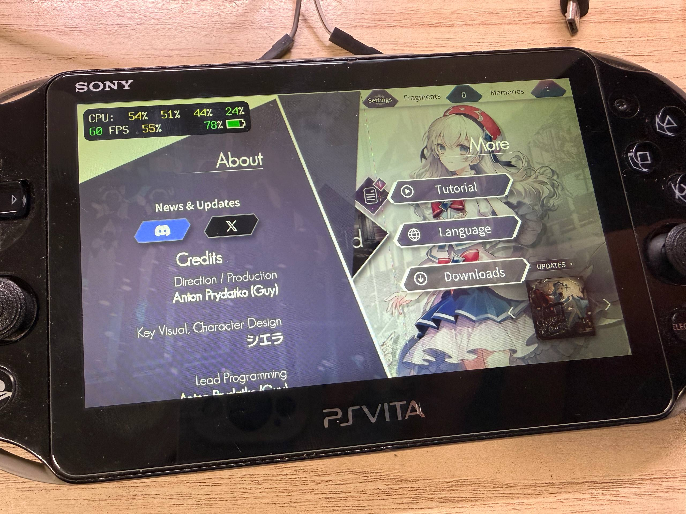
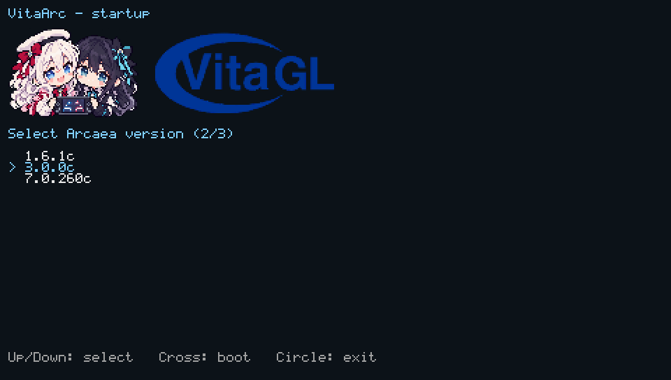

# VitaArc

An Android ABI bridge for running Arcaea on a HENkaku-enabled PlayStation Vita.
**Under development; game compatibility is incomplete.**

Arcaea is developed by lowiro. VitaArc is not affiliated with lowiro or Arcaea.

## Showcase



VitaArc running on real PlayStation Vita hardware.



VitaArc startup screen with Arcaea version selection.

## Install

1. Install `VitaArc.vpk` with VitaShell. The VPK contains the application only.
2. Prepare resources from your own official APK on a computer:

   ```sh
   python -m pip install -r tools/requirements.txt
   python tools/package_apk.py --apk third-party/arcaea/arcaea_1.6.1c.apk --output build/game-resources
   ```

   Add `--obb /path/to/main.obb` for an external expansion file; repeat for more files.
   To prepare every APK in a directory, use `--apk-dir third-party/arcaea --all`
   instead of `--apk`. Prepare external OBB files one version at a time.
3. Copy the generated `version` directory to `ux0:data/vitaarc/`:

   ```text
   ux0:data/vitaarc/
     version/
       1.6.1c/
         assets/
         obb/
         lib/armeabi-v7a/libcocos2dcpp.so
         vitaarc-apk-version.txt
   ```

4. Launch VitaArc. Use the directional buttons to choose a version, Cross to boot,
   or Circle to exit. Version labels come from directory names. The selection is
   logged; the logo and title stay fixed above the scrolling log.

Logs and saved data are stored under `ux0:data/vitaarc/`. Preparing another version
preserves existing version directories; remove an existing directory explicitly
before rebuilding that version.

## Resource preparation

The script keeps game assets, OBB files and the ARMv7 `libcocos2dcpp.so`. It removes
Android UI resources, manifests, bytecode, signatures and other native libraries.

PNG and JPEG textures in APK assets use one size rule shared with Cocos:

- Keep images whose shorter side is below 64 pixels or longer side is below 256
  pixels, including 1×1 dots. Oversized narrow images are limited to 4096 pixels.
- Halve other images at least once, then repeat until the longer side is at most
  960 pixels. Round each halved dimension up and preserve the aspect ratio.

Processed images embed their original dimensions so Cocos can retain layout and
atlas coordinates. No separate texture definition file is needed. OBB files are
copied unchanged; textures inside OBB files are not resampled.

## Build and test

With VitaSDK and the project's Vita libraries installed:

```sh
bash build.sh
python3 tools/check_vpk.py build/VitaArc.vpk
```

Builds always produce an application-only VPK. Prepare and copy game resources
separately.

Run resource and release tests with Python, Pillow and Git:

```sh
python3 -m unittest discover -s tests -p 'test_package*.py'
python3 -m unittest discover -s tests -p 'test_release_tools.py'
```

Run the bridge mock tests on Linux or WSL without an APK, Vita or VitaSDK.
On Ubuntu, install `build-essential cmake python3 python3-pil libffi-dev
libvorbis-dev libfreetype-dev libpng-dev fonts-dejavu-core` first.

```sh
cmake -S tests -B build/host-tests -DCMAKE_BUILD_TYPE=Debug
cmake --build build/host-tests --parallel 2
ctest --test-dir build/host-tests --output-on-failure
```

The bridge suite enables AddressSanitizer and UndefinedBehaviorSanitizer by
default. See [tests/README.md](tests/README.md) for coverage and limitations.

## CI and releases

GitHub Actions and GitLab CI run host tests, build with VitaSDK and verify that
the VPK contains only application files. Successful branch pushes and manually
started branch builds publish
`nightly-<full commit SHA>` with `VitaArc.vpk` and commit history since the previous
nightly. The first nightly includes the available commit history.

GitHub also builds pushed `v*` tags (for example, `v1.0`) and publishes a regular
Release with `VitaArc.vpk` and generated release notes after tests pass. GitLab
publishes branch nightlies only.

Pull and merge requests build without publishing. Reruns reuse the same release and
recover incomplete uploads. GitLab stores release VPKs in the generic package
registry so they outlive temporary pipeline artifacts.

Game resources and APKs are never included in CI artifacts or release attachments.

## Licenses

Bitmap text rendering uses FreeType; its license is included as
`licenses/freetype.txt` in the VPK. Text uses fonts from the selected APK.
